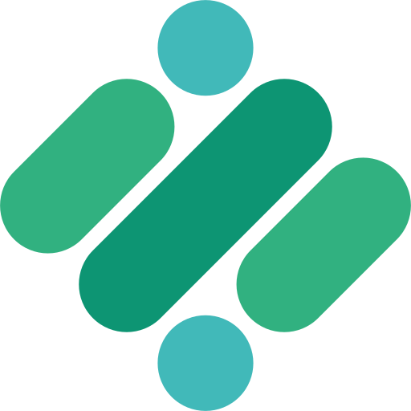
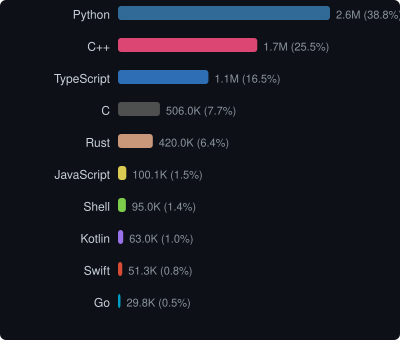
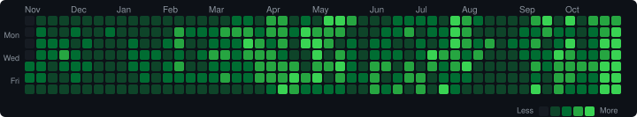
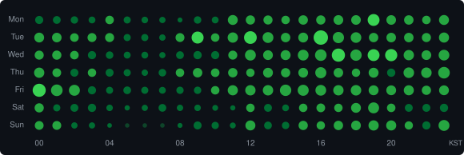
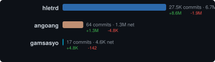

  <picture>
    <source media="(prefers-color-scheme: dark)" srcset="assets/mark_dark.png" />
    <source media="(prefers-color-scheme: light)" srcset="assets/mark_light.png" />
    
  </picture>
  <h1>Xylolabs Inc.</h1>
  
<strong>Edge Physical AI that catches equipment faults and runs robots.</strong>

  
Sensors, edge AI and robots for port cranes, power plants and factories.

  
  
  
  
  
    
  
  
  

---

### Platforms

| Platform | What it does |
|----------|--------------|
| [**XyloZero**](https://xylolabs.com/en/solutions/xylo-zero/) | Edge AI that reads sensor signals with PLC and drive data to catch equipment anomalies early |
| [**Battery Fire Early Detection**](https://xylolabs.com/en/solutions/battery-early-warning/) | Hears the acoustic precursors of thermal runaway in AGV, AMR and ESS batteries |
| [**Autonomy & Robotics**](https://xylolabs.com/en/solutions/robotics/) | On-device AI for robot and drone patrols, VLA manipulation learning and port crane autonomy |

### In the Field

- **Ports** — STS crane condition monitoring at a major Korean container terminal, in operation
- **Power** — conveyor monitoring pilot and gas turbine predictive maintenance PoC
- **Manufacturing** — battery fire precursor validation and shipyard equipment PoC
- **Public** — 2026 on-device AI public service pilot with robots and drones

### Core Tech

- **Sensor hardware** — in-house multi-sensor boards with Rust `no_std` firmware
- **Data platform** — streams high-resolution audio and sensor data from edge devices
- **On-device AI** — anomaly models and LLMs running on our sensors and robots
- **Edge NPU optimization** — speech, sound and language models run on the NPUs inside our robots, not in the cloud: open LLMs quantized to block floating-point (BFP4/BFP8) with GPTQ, our own NPU kernels and an on-device runner. Open: [quantizer](https://github.com/XylolabsInc/tensix-bfp-gptq) · [kernels](https://github.com/XylolabsInc/tensix-kernels) · [models on Hugging Face](https://huggingface.co/Xylolabs)

### Company

Started as signal research at Seoul National University in 2019, incorporated in December 2025. Patent pending on multimodal data acquisition for anomaly detection.

**Programs:** MYSC EMA Original 2026 · BNK 2026 CHAIN-G · CMK Impactpreneur Cohort 14 · Shinhan BLUEWAVE Cohort 12 · MYSC Marine Accelerator Program

### Repositories

<!-- REPOS_START -->

| Repository | Description | Language |
|-----------|-------------|----------|
| [**.github**](https://github.com/XylolabsInc/.github) |  |  |
| [**tensix-bfp-gptq**](https://github.com/XylolabsInc/tensix-bfp-gptq) | Quantize Hugging Face LLMs to Tenstorrent TT-NN's BFP4/BFP8 formats (bfloat4_b, bfloat8_b) with GPTQ, for Tensix NPUs | `Python` |
| [**tensix-kernels**](https://github.com/XylolabsInc/tensix-kernels) | Device kernels for LLM inference on Tenstorrent Tensix NPUs, launched from Python through ttnn | `C++` |
| [**Xylolabs-Knowledge-Engine**](https://github.com/XylolabsInc/Xylolabs-Knowledge-Engine) | Unified Knowledge Base Engine — continuously ingests Slack, Google Workspace, and Notion into a searchable AI-powered knowledge base with a Slack bot interface | `JavaScript` |

<!-- REPOS_END -->

### Organization Stats

<!-- STATS_START -->

| Metric | Value | Metric | Value |
|--------|-------|--------|-------|
| **Estimated LOC** | 7.0M | **Active days (1y)** | 366 |
| **Total Commits** | 31.8K | **Avg / week (90d)** | 1.3K |
| **Commits (30d)** | 11.5K | **Peak weekday** | Wed |
| **Contributors** | 4 | | |

#### Languages

#### Activity (last 52 weeks)

Peak day: 2026-11-10 with 1585 commits.

#### Weekly Activity Pattern

Peak hour: Tue 16:00 KST (627 commits).

#### Contributor Insights

Last updated: 2026-11-12
<!-- STATS_END -->

---

  <a href="https://xylolabs.com/en/">xylolabs.com</a>

